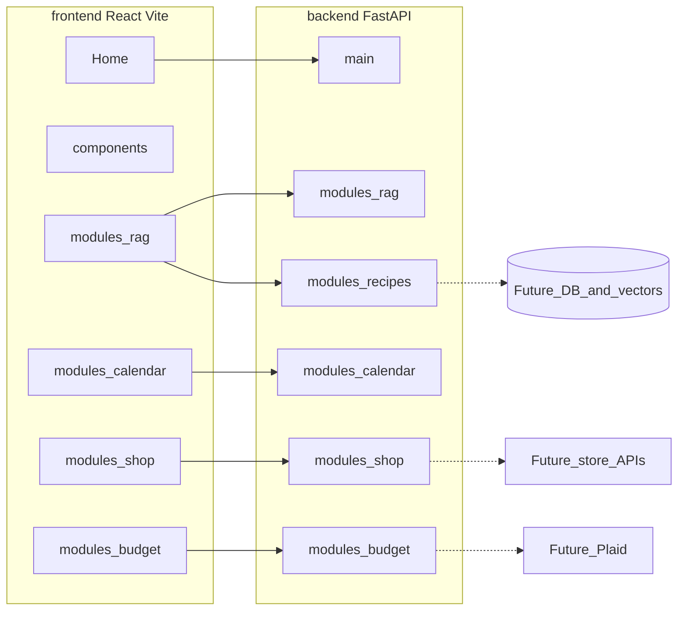

# Thyme schematic

Team-friendly layout for the AI meal-planning app. Each capability owns a matching backend + frontend folder so work does not overlap.

## Ownership

| Area | Backend | Frontend | Person |
|------|---------|----------|--------|
| RAG / Understand | `backend/app/modules/rag` + `recipes` | `frontend/src/modules/rag` | TBD |
| Plan | `backend/app/modules/calendar` | `frontend/src/modules/calendar` | TBD |
| Shop | `backend/app/modules/shop` | `frontend/src/modules/shop` | TBD |
| Budget | `backend/app/modules/budget` | `frontend/src/modules/budget` | TBD |
| Shared UI / shell | — | `frontend/src/components`, `pages` | TBD |
| API core / wiring | `backend/app/main.py`, `modules/shared` | — | TBD |

## Architecture

## Next sprint: RAG recipes

Intended flow (stubs only today):

1. User uploads recipes → `recipes` module stores them
2. `rag` module embeds + indexes recipe text
3. Chat UI in `frontend/src/modules/rag` calls `/api/rag/chat`
4. Answers come from retrieved user recipes (“lots of potatoes”, “I’m busy”, etc.)

Entry points:

- Backend: `backend/app/modules/recipes/service.py`, `backend/app/modules/rag/service.py`
- Frontend: `frontend/src/modules/rag/RagPage.tsx`

## Local shape

- Web: Vite on `http://localhost:5173` (proxies `/api` → API)
- API: FastAPI on `http://127.0.0.1:8080`

## LLM / BYOK

- Default local: Ollama `qwen2.5:7b` via `shared/llm.py`
- Per-user OpenAI/Anthropic keys via `settings` module (encrypted)
- Production auth: Cognito (Plan B); local uses `local-dev` user

## AWS Plan B (Terraform written, not applied)

See [PLAN_B_AWS.md](PLAN_B_AWS.md).

- Frontend: S3 + CloudFront
- Auth: Cognito
- BYOK + recipes: DynamoDB
- Fernet key: SSM SecureString
- API host: decide after approval (laptop vs Lambda)
