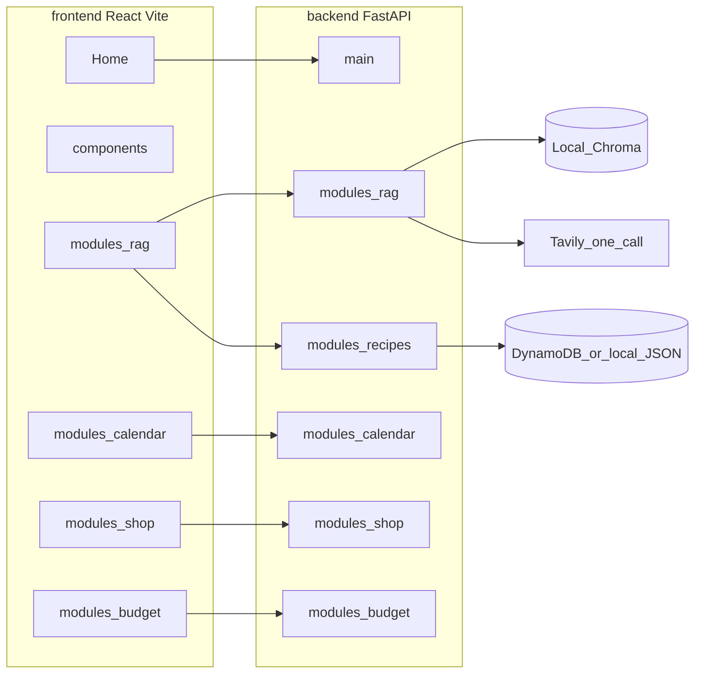

# Thyme schematic

Team-friendly layout for the AI meal-planning app. Each capability owns a matching backend + frontend folder so work does not overlap.

## Ownership

| Area | Backend | Frontend | Person |
|------|---------|----------|--------|
| RAG / Find | `backend/app/modules/rag` + `recipes` | `frontend/src/modules/rag` | TBD |
| Plan | `backend/app/modules/calendar` | `frontend/src/modules/calendar` | TBD |
| Shop | `backend/app/modules/shop` | `frontend/src/modules/shop` | TBD |
| Budget | `backend/app/modules/budget` | `frontend/src/modules/budget` | TBD |
| Shared UI / shell | — | `frontend/src/components`, `pages` | TBD |
| API core / wiring | `backend/app/main.py`, `modules/shared` | — | TBD |

## Architecture

## LLM Phase 1: filter-driven recipe RAG (non-agentic)

Not a chatbot. Users set filters; the API runs a fixed pipeline.

1. User uploads PDF/TXT → `recipes` extracts text → LLM normalizes to recipe JSON → store (local JSON or DynamoDB `thyme-recipes`)
2. `rag` embeds into **local Chroma** (per user) with MiniLM
3. Find / Upload UI calls `POST /api/rag/search` with filters (include/exclude ingredients, time, difficulty, cuisine, optional semantic hint, web toggle)
4. Pipeline: hard filter + semantic rank → optional **one** Tavily web search → normalize/import web hits → return ranked recipe cards

Entry points:

- Backend: `backend/app/modules/recipes/`, `backend/app/modules/rag/`
- Frontend: `frontend/src/modules/rag/RagPage.tsx`

Agentic multi-tool planning is later — Phase 1 allows only that single web search call.

## Local shape

- Web: Vite on `http://localhost:5173` (proxies `/api` → API)
- API: FastAPI on `http://127.0.0.1:8080`

## LLM / BYOK

- Default local: Ollama `qwen2.5:7b` via `shared/llm.py` (used to normalize uploads/web text)
- Per-user OpenAI/Anthropic keys via `settings` module (encrypted)
- Production auth: Cognito (Plan B); local uses `local-dev` user

## AWS infra Phase 1 (applied — naming differs from LLM Phase 1)

See [PLAN_B_AWS.md](PLAN_B_AWS.md).

- Frontend: S3 + CloudFront
- Auth: Cognito
- BYOK + recipes: DynamoDB
- Fernet key: SSM SecureString
- API host: laptop until a later step
